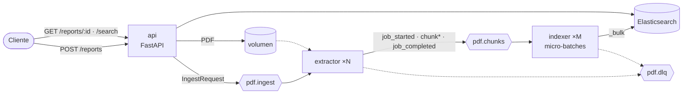

# Procesador Desestructurado Asíncrono de PDFs

[](https://github.com/galvysRodriguez/redis-fast-api/actions/workflows/ci.yml)


[](LICENSE)

Microservicio orientado a eventos que recibe **reportes complejos en PDF**, extrae las **tablas
con Docling** y el **texto con Unstructured** en paralelo, y los **indexa en micro-batches** a
través de **Apache Kafka** hacia Elasticsearch, listos para búsqueda full-text o como base de un
sistema RAG.

```text
PDF ──► API (202) ──► Kafka ──► Extractor ──► Kafka ──► Indexer ──► Elasticsearch ──► /search
                                Docling ∥ Unstructured        micro-batches + _bulk
```

## Características

- **Ingesta asíncrona:** la API responde `202 Accepted` al instante; el procesamiento pesado
  ocurre en workers desacoplados por Kafka.
- **Tablas estructuradas:** Docling (TableFormer) reconstruye columnas, filas, caption y
  Markdown de cada tabla.
- **Chunking semántico:** Unstructured clasifica el texto y lo agrupa por secciones
  (`chunk_by_title`).
- **Sin duplicados:** el texto que cae dentro de las tablas de Docling se descarta usando sus
  *bounding boxes*.
- **Micro-batching real:** el indexador acumula hasta N mensajes o T milisegundos y hace un único
  `_bulk`.
- **Entrega garantizada:** *at-least-once* con escrituras idempotentes, reintentos con backoff y
  dead-letter queue.
- **Escalable horizontalmente:** extractores e indexadores escalan por separado según las
  particiones.
- **Observable:** estado por job, métricas de extracción, logs por lote y Kafka UI incluida.

## Arquitectura



| Servicio | Responsabilidad | Código |
|---|---|---|
| **api** | Valida y guarda el PDF, registra el job, publica en `pdf.ingest`. Expone estado, chunks y búsqueda. | [`pdfproc/api`](pdfproc/api/main.py) |
| **extractor** | Corre Docling y Unstructured en paralelo, filtra solapamientos y publica los chunks en `pdf.chunks`. | [`pdfproc/extractor`](pdfproc/extractor/worker.py) |
| **indexer** | Forma micro-batches, indexa con la Bulk API, actualiza el estado de los jobs y manda los fallos a la DLQ. | [`pdfproc/indexer`](pdfproc/indexer/worker.py) |

Detalle completo (diagrama de secuencia, contratos de mensajes, tabla de fallos):
**[docs/ARCHITECTURE.md](docs/ARCHITECTURE.md)**.
Por qué se hizo así y qué problemas aparecieron al ejecutarlo:
**[docs/DECISIONS.md](docs/DECISIONS.md)**.

## Stack

| Capa | Tecnología |
|---|---|
| API | FastAPI, Uvicorn, Pydantic v2 |
| Mensajería | Apache Kafka 3.9 (KRaft, sin ZooKeeper), aiokafka |
| Extracción de tablas | Docling (TableFormer, modo ACCURATE) |
| Extracción de texto | Unstructured (`partition_pdf`, `chunk_by_title`) |
| Indexación | Elasticsearch 8 (Bulk API, cliente async) |
| Infraestructura | Docker Compose, Kafka UI |
| Calidad | Pytest, Ruff, GitHub Actions |

## Inicio rápido

**Requisitos:** Docker con Compose v2 (o Podman) y ~4 GB de RAM libres.

```bash
git clone https://github.com/galvysRodriguez/redis-fast-api.git
cd redis-fast-api
cp .env.example .env
make up          # construye y levanta: kafka, elasticsearch, api, extractor, indexer, kafka-ui
```

- El primer build del extractor tarda varios minutos (torch CPU + Docling + spaCy).
- En el primer arranque, el extractor descarga los modelos de Docling a un volumen persistente.

| URL | Servicio |
|---|---|
| http://localhost:8001/docs | Swagger de la API (puerto configurable con `API_PORT`) |
| http://localhost:8080 | Kafka UI: topics, mensajes, lag de consumidores |
| http://localhost:9200 | Elasticsearch |

<details>
<summary>Usar con Podman rootless</summary>

```bash
systemctl --user enable --now podman.socket
export DOCKER_HOST=unix://$XDG_RUNTIME_DIR/podman/podman.sock
make up
```
</details>

## Demo

El repo incluye un reporte de ejemplo ([`examples/informe_q3.pdf`](examples/informe_q3.pdf)): 2
páginas con texto y 2 tablas. Todas las salidas siguientes son **reales**, capturadas del stack
en ejecución.

### 1. Enviar el reporte

```bash
$ curl -F "file=@examples/informe_q3.pdf" localhost:8001/reports
```
```json
{"job_id":"058a0377b562436b8d78326ac27f940f","status":"queued","status_url":"/reports/058a0377b562436b8d78326ac27f940f"}
```

O en un solo paso, esperando el resultado: `make submit FILE=examples/informe_q3.pdf`.

### 2. Consultar el estado

`queued` → `processing` → `completed`:

```bash
$ curl localhost:8001/reports/058a0377b562436b8d78326ac27f940f
```
```json
{
  "job_id": "058a0377b562436b8d78326ac27f940f",
  "filename": "informe_q3.pdf",
  "status": "completed",
  "submitted_at": "2026-10-24T19:36:38.299977+00:00",
  "started_at": "2026-10-24T19:36:38.353074+00:00",
  "finished_at": "2026-10-24T19:36:58.013245+00:00",
  "extraction_seconds": 19.609,
  "total_chunks": 5,
  "text_chunks": 3,
  "table_chunks": 2,
  "indexed_chunks": 5
}
```

### 3. Tablas extraídas por Docling

```bash
$ curl "localhost:8001/reports/058a0377b562436b8d78326ac27f940f/chunks?kind=table"
```
```json
{
  "chunk_id": "058a0377b562436b8d78326ac27f940f-table-00000",
  "kind": "table",
  "page_numbers": [1],
  "table": {
    "caption": "Tabla 1. Ingresos por región (millones USD)",
    "columns": ["Región", "Q1", "Q2", "Q3"],
    "rows": [
      ["Norteamérica",  "120.5", "131.2", "140.8"],
      ["Latinoamérica", "45.3",  "52.1",  "61.7"],
      ["Europa",        "88.0",  "85.4",  "90.2"]
    ],
    "markdown": "| Región        |    Q1 |    Q2 |    Q3 |\n|---------------|-------|..."
  }
}
```

### 4. Búsqueda full-text

```bash
$ curl "localhost:8001/search?q=margen%20bruto"
```
```json
{
  "total": 1,
  "items": [{
    "chunk_id": "058a0377b562436b8d78326ac27f940f-text-00001",
    "kind": "text",
    "score": 4.32,
    "page_numbers": [1, 2],
    "highlight": ["Costos y márgenes\n\nEl <em>margen</em> <em>bruto</em> se ubicó en 42%, ..."]
  }]
}
```

### 5. Logs del pipeline

```text
indexer   | Lote: 1 registros -> 0 chunks (0 texto, 0 tablas), 1 eventos en 27 ms      ← job_started
extractor | Docling: 2 tablas en /data/uploads/3a88f7ad....pdf
extractor | Unstructured: 37 elementos (30 dentro de tablas) -> 3 chunks
extractor | Job 3a88f7ad... extraído en 19.1s: 3 texto, 2 tablas
indexer   | Job 3a88f7ad... completed (5/5 chunks)
indexer   | Lote: 6 registros -> 5 chunks (3 texto, 2 tablas), 1 eventos en 110 ms     ← 5 chunks en un _bulk
```

Con el procesamiento del PDF de por medio, el indexador ve dos lotes: el primero trae el evento
`job_started` y el segundo los 5 chunks más `job_completed`, todos indexados en un solo `_bulk`.

## API

| Método | Ruta | Descripción |
|---|---|---|
| `POST` | `/reports` | Sube un PDF (`multipart/form-data`, campo `file`). Responde `202` con `job_id`. `415` si no es PDF, `413` si supera `MAX_UPLOAD_MB`. |
| `GET` | `/reports/{job_id}` | Estado y métricas del job. `404` si no existe. |
| `GET` | `/reports/{job_id}/chunks` | Chunks del job. Filtros: `kind=text\|table`, `size`, `offset`. |
| `GET` | `/search` | Búsqueda full-text con resaltado. Parámetros: `q`, `kind`, `job_id`, `size`. |
| `GET` | `/health` | Healthcheck (incluye Elasticsearch). |

Estados de un job: `queued` · `processing` · `completed` · `completed_with_errors` · `failed`.

## Fiabilidad

| Mecanismo | Cómo |
|---|---|
| Sin pérdida de mensajes | Commit manual de offsets *después* de publicar/indexar; producer con `acks=all` e idempotencia |
| Sin duplicados | `_id` determinista `{job_id}-{kind}-{seq}`: reprocesar sobrescribe |
| Orden por job | `job_id` como key: todos los mensajes del job van a la misma partición |
| Errores transitorios | Reintento con backoff exponencial solo de los documentos fallidos (429/5xx) |
| Errores permanentes | Dead-letter queue `pdf.dlq` con payload, etapa y error |
| PDFs lentos | Extracción en hilos fuera del event loop + `max_poll_interval_ms` de 1 h |

Ver la [tabla completa de escenarios de fallo](docs/ARCHITECTURE.md#semántica-de-entrega-y-fallos).

```bash
make dlq    # inspeccionar la dead-letter queue
```

## Escalado

```bash
make scale EXTRACTORS=4 INDEXERS=2
```

- Los extractores escalan hasta 6, el número de particiones de `pdf.ingest`.
- Los indexadores escalan hasta 12, las particiones de `pdf.chunks`.
- El lag de los grupos `pdf-extractor` y `pdf-indexer` se ve en Kafka UI.

## Configuración

Variables de entorno (ver [`.env.example`](.env.example) y [`pdfproc/config.py`](pdfproc/config.py)):

| Variable | Defecto | Descripción |
|---|---|---|
| `API_PORT` | `8000` | Puerto de la API en el host |
| `MAX_UPLOAD_MB` | `100` | Tamaño máximo del PDF |
| `UNSTRUCTURED_STRATEGY` | `fast` | `hi_res` usa un modelo de layout (más lento, mejor en PDFs complejos) |
| `DOCLING_DO_OCR` | `false` | OCR con Tesseract (español + inglés) para PDFs escaneados |
| `CHUNK_MAX_CHARS` | `1500` | Tamaño máximo de un chunk de texto |
| `BATCH_MAX_RECORDS` | `500` | Tamaño máximo del micro-batch |
| `BATCH_MAX_WAIT_MS` | `2000` | Ventana máxima del micro-batch |
| `BULK_MAX_RETRIES` | `5` | Reintentos del bulk ante 429/5xx |
| `EXTRACTOR_REPLICAS` / `INDEXER_REPLICAS` | `1` | Réplicas iniciales |

## Estructura del proyecto

```text
.
├── pdfproc/
│   ├── api/main.py                  # FastAPI: ingesta, estado, búsqueda
│   ├── extractor/
│   │   ├── worker.py                # consumidor de pdf.ingest, orquesta la extracción
│   │   ├── docling_tables.py        # tablas + bounding boxes con Docling
│   │   ├── unstructured_text.py     # partición, filtro por regiones y chunking
│   │   └── pipeline.py              # tipos y ensamblado de chunks (sin dependencias pesadas)
│   ├── indexer/
│   │   ├── worker.py                # consumidor de pdf.chunks, bulk + estado de jobs
│   │   └── batching.py              # micro-batching y clasificación de errores del bulk
│   ├── schemas.py                   # contratos de mensajes (Pydantic)
│   ├── messaging.py                 # clientes Kafka con reintentos, DLQ
│   ├── storage.py                   # índices y estado en Elasticsearch
│   └── config.py                    # configuración por entorno
├── docker/                          # un Dockerfile por servicio
├── docs/                            # arquitectura y decisiones técnicas
├── examples/informe_q3.pdf          # reporte de ejemplo
├── scripts/                         # submit.sh, generador del PDF de ejemplo
├── tests/                           # tests unitarios
└── docker-compose.yml
```

## Desarrollo

```bash
make venv     # entorno virtual con dependencias de desarrollo
make test     # pytest (no necesita Kafka, Elasticsearch ni Docling)
make lint     # ruff check + format --check
make logs     # logs de api, extractor e indexer
```

Los tests cubren la lógica pura: ensamblado de chunks, IDs deterministas, filtrado por regiones,
micro-batching con un consumidor simulado y clasificación de errores del bulk. El CI ejecuta
lint, tests y build de imágenes en cada push.

## Hoja de ruta

- [ ] Almacenamiento en S3/MinIO en lugar de volumen compartido (despliegue multi-host)
- [ ] Embeddings por lote en el indexador (`dense_vector`) para búsqueda semántica / RAG
- [ ] Métricas Prometheus (lag, latencia por etapa, tamaño de lote) y dashboard Grafana
- [ ] Tests de integración con Testcontainers (Kafka + Elasticsearch)
- [ ] Kafka con 3 brokers, `replication.factor=3`, `min.insync.replicas=2`

## Licencia

[MIT](LICENSE) © Galvys Rodriguez
