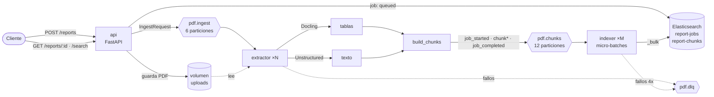
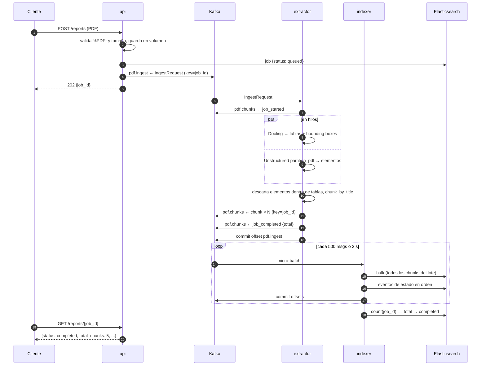

# Arquitectura

Documento técnico del flujo de datos, los contratos de mensajes y el comportamiento ante fallos.
Para la visión general ver el [README](../README.md); para el porqué de cada decisión, [DECISIONS.md](DECISIONS.md).

## Componentes



| Componente | Escala con | Estado |
|---|---|---|
| `api` | réplicas detrás de un balanceador | sin estado |
| `extractor` | particiones de `pdf.ingest` (6) | sin estado; modelos en volumen |
| `indexer` | particiones de `pdf.chunks` (12) | sin estado |

## Secuencia de un job



## Contratos de mensajes

Definidos en [`pdfproc/schemas.py`](../pdfproc/schemas.py) con Pydantic. Todos se serializan como JSON.

### `pdf.ingest`

```json
{
  "job_id": "058a0377b562436b8d78326ac27f940f",
  "filename": "informe_q3.pdf",
  "path": "/data/uploads/058a0377b562436b8d78326ac27f940f.pdf",
  "submitted_at": "2026-10-24T19:36:38.299977Z"
}
```

### `pdf.chunks`

Unión discriminada por `type`. Todos los mensajes de un job usan `job_id` como key.

| `type` | Campos | Efecto en el indexador |
|---|---|---|
| `job_started` | `job_id`, `started_at` | job → `processing` |
| `chunk` | `chunk_id`, `kind` (`text`\|`table`), `seq`, `text`, `page_numbers`, `element_types`, `table?` | documento en `report-chunks` (`_id = chunk_id`) |
| `job_completed` | `total_chunks`, `text_chunks`, `table_chunks`, `extraction_seconds` | cuenta lo indexado → `completed` \| `completed_with_errors` |
| `job_failed` | `error` | job → `failed` |

`table` contiene `columns`, `rows` (matriz de strings), `markdown` y `caption`.

### `pdf.dlq`

```json
{
  "stage": "extractor",
  "source_topic": "pdf.ingest",
  "key": "roto",
  "payload": "{\"esto no es\":\"un IngestRequest\"}",
  "error": "mensaje inválido: 3 validation errors for IngestRequest ...",
  "failed_at": "2026-10-24T19:03:52.614203Z"
}
```

## Índices de Elasticsearch

| Índice | `_id` | Uso |
|---|---|---|
| `report-chunks` | `chunk_id` | búsqueda full-text sobre `text`; `table` se guarda sin indexar (`enabled: false`) |
| `report-jobs` | `job_id` | estado y métricas de cada job |

Mappings en [`pdfproc/storage.py`](../pdfproc/storage.py).

## Semántica de entrega y fallos

| Escenario | Comportamiento |
|---|---|
| Mensaje con JSON/contrato inválido | → `pdf.dlq`, se confirma el offset y el worker sigue |
| PDF corrupto / excepción en Docling o Unstructured | `job_failed` + `pdf.dlq`; el job queda `failed` |
| El extractor muere en mitad de un PDF | offset no confirmado → otra réplica reprocesa el job; los `chunk_id` son deterministas, se sobrescriben |
| ES responde 429/5xx en el bulk | reintento con backoff exponencial solo de los documentos fallidos |
| ES responde 4xx a un documento | ese chunk → `pdf.dlq`; el job termina `completed_with_errors` |
| ES caído tras `BULK_MAX_RETRIES` | el worker termina sin confirmar el lote; Docker lo reinicia y el lote se reentrega |
| Rebalanceo durante el commit | `CommitFailedError` registrado; el lote se reentrega (idempotente) |
| PDF que tarda minutos | extracción fuera del event loop + `max_poll_interval_ms` de 1 h: Kafka no expulsa al consumidor |
| Corte de red al descargar modelos | el extractor reintenta 5 veces al arrancar; los modelos quedan en el volumen |

**Garantía resultante:** *at-least-once* con escrituras idempotentes, es decir,
*effectively-once* en Elasticsearch.

## Micro-batching

[`collect_batch`](../pdfproc/indexer/batching.py) acumula registros hasta `BATCH_MAX_RECORDS` o
hasta que vence la ventana `BATCH_MAX_WAIT_MS`. `getmany()` de aiokafka devuelve en cuanto hay
*algún* dato, así que sin esta capa los lotes serían de pocos mensajes en carga baja/media.

Por cada lote:

1. Se parsean todos los mensajes (los inválidos → DLQ).
2. Se deduplican los chunks por `chunk_id` y se envían en **un único** `_bulk`.
3. Se aplican los eventos de estado **en orden de llegada**.
4. Se confirman los offsets.

Como un job vive en una sola partición y su `job_completed` llega después de sus chunks, en el
paso 3 todos sus chunks ya están en Elasticsearch, incluso si llegaron en lotes anteriores.
